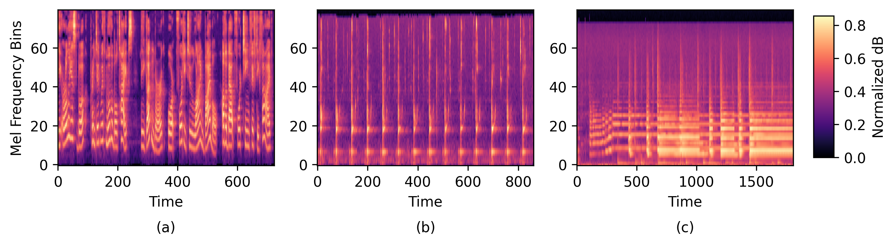
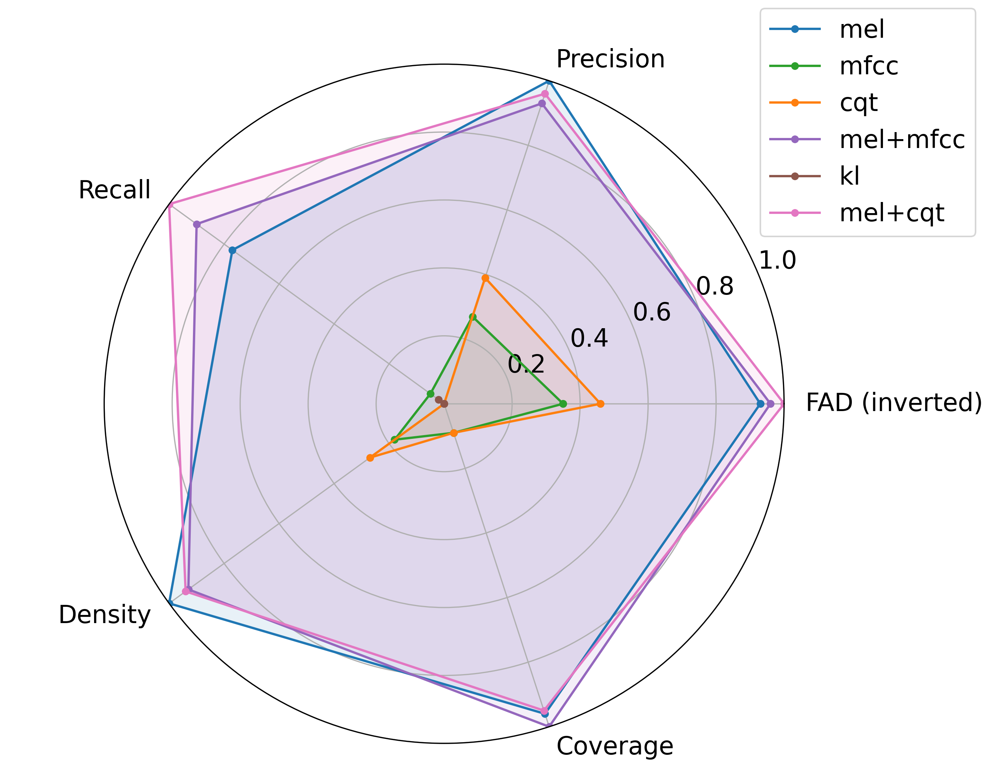

## Overview

This project studies how the representation used to condition a diffusion model changes generated audio quality across speech, environmental sounds and music.

## Research problem and motivation

DiffWave commonly uses Mel spectrogram conditioning, but different time-frequency and transformed representations preserve different aspects of temporal, harmonic and timbral structure. The study evaluates those choices systematically rather than assuming one representation transfers equally well across audio domains.

## Approach and methodology

Starting from DiffWave, the implementation compares Mel spectrograms, MFCCs, CQT, KLT, Mel+MFCC and Mel+CQT conditioning. Experiments use LJSpeech, ESC-50 and IRMAS. Evaluation includes Fréchet Audio Distance together with precision, recall, density and coverage.

## My contribution

Sandunika is a co-author and contributor to the public implementation. The paper and repository establish a collaborative research project; they do not provide a task-by-task individual contribution statement.

## Key results

Mel+CQT produced the lowest reported FAD across all three datasets: 5.45 for LJSpeech, 6.71 for ESC-50 and 4.60 for IRMAS, compared with Mel baselines of 6.19, 8.38 and 5.63. The broader metric plots show that individual representations can remain stronger on particular criteria, so the result is framed as an overall experimental balance rather than universal superiority.

## Technologies and methods

- DiffWave and denoising diffusion
- Mel spectrogram, MFCC, CQT and KLT features
- LJSpeech, ESC-50 and IRMAS datasets
- Fréchet Audio Distance and PRDC metrics
- PyTorch audio preprocessing and waveform generation

## Code and publication

- [Code](https://github.com/sandunikalakmali/conditional-audiogen)
- [Paper — ICIIS](https://doi.org/10.1109/ICIIS69028.2026.11450741)

## Research figures

The first figure is the original project visualization. The second summarizes the LJSpeech evaluation across the compared conditioning representations; individual axes should be read separately rather than as evidence that one representation dominates every criterion.

*The cover is a conceptual illustration; both figures above come from the research implementation.*
