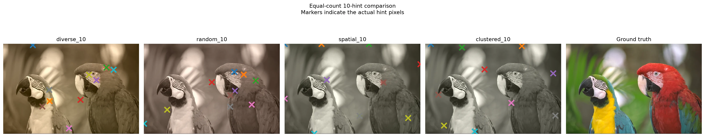

## Overview

HeritageAI is a broader research initiative investigating computational restoration of degraded Sri Lankan historical imagery. One concrete research outcome within that initiative is **Colour-INR**, a controllable image-colorization method based on implicit neural representations.

## Research problem and motivation

Archival photographs can combine noise, fading, low spatial resolution, missing colour information and physical damage. Colourization is particularly underdetermined: many chrominance assignments can fit the same luminance image, so user guidance and edge preservation matter when plausible alternatives exist.

## Approach and methodology

The wider initiative studies implicit neural representations and diffusion-based restoration. Colour-INR represents an image as a coordinate-based neural function that predicts chrominance from spatial coordinates and luminance context. Sparse colour hints guide ambiguous regions, while edge-aware regularization discourages colour bleeding across structural boundaries. Evaluation uses the Kodak image set with equal-count hint controls so comparisons with other guided colorization baselines remain fair.

The work is supported under the NVIDIA Academic Grant Program.

## My contribution

Sandunika is a lead-listed author of the Colour-INR manuscript and contributes to the wider HeritageAI restoration research. The public materials do not assign every experiment and implementation task to an individual author, so the broader initiative is presented collaboratively.

## Current outcome

Colour-INR is **under review for ICLR 2027** and is not an accepted ICLR paper. The manuscript reports competitive Kodak comparisons under matched hint counts; this page does not claim that it outperforms every baseline or that the displayed Kodak example is a restored historical photograph. A consolidated public implementation is not currently linked.

## Technologies and methods

- Implicit neural representations
- Diffusion models
- Image denoising and super-resolution
- Coordinate-based chrominance prediction
- Sparse colour hints and edge-aware regularization
- Colour-guided image colorization
- Computational imaging

## Research figure

*Figure: genuine Colour-INR experimental comparison on Kodak image 23. It is a benchmark result, not a Sri Lankan archival restoration. The cover remains a conceptual illustration.*
