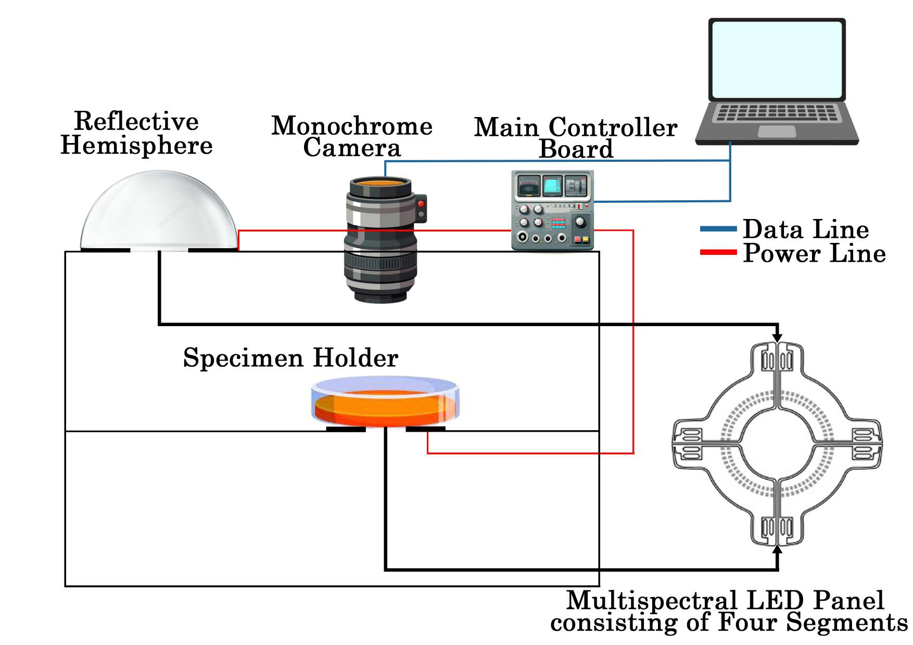

## Overview

This project combines reflectance multispectral imaging with machine learning to characterize soil texture without relying solely on conventional laboratory particle-size analysis.

## Research problem and motivation

Clay, silt and sand proportions influence agricultural water availability and erosion as well as geotechnical load-bearing and shrink–swell behaviour. The study asks whether controlled spectral measurements can support both continuous composition estimation and categorical USDA texture classification.

## Approach and methodology

A custom 13-band system records reflectance from 365–940 nm. The reproducible pipeline applies dark-current correction, a fixed region of interest, bounded normalization and block-level spectral feature extraction. Grouped evaluation keeps all blocks from one physical specimen in the same fold.

Three related tasks are kept distinct:

1. **Direct classification** predicts one of the twelve USDA texture classes.
2. **Composition regression** estimates clay, silt and sand percentages.
3. **Indirect classification** maps the regressed composition through the USDA texture triangle.

## My contribution

Sandunika is first author and shares equal contribution with Senith Jayakody on the associated IEEE Access article. The public sources establish shared leadership but do not assign every acquisition, software and analysis task to an individual author.

## Key results and limitations

The IEEE Access study reports clay, silt and sand regression performance reaching R² values of approximately 0.99 and direct USDA texture-classification accuracy above 99% in its controlled-mixture experiments. These publication results have a narrower scope than field validation: the samples were prepared from three source soils, and geographically independent soils and acquisition conditions remain future validation needs. Repository outputs from later reproducibility checks are not merged with the paper's final reported metrics.

## Technologies and methods

- 13-band reflectance multispectral imaging
- Dark-current correction and spectral feature extraction
- Grouped cross-validation and training-only preprocessing
- KNN, ensemble models and composition regression
- USDA texture-triangle mapping

## Code and publication

- [Code](https://github.com/sandunikalakmali/soil-texture-msi)
- [Paper — IEEE Access, 2026](https://doi.org/10.1109/ACCESS.2026.3721276)

## Research figure

*Figure: genuine project system/research visual retained from the original page. The cover is a conceptual illustration.*
