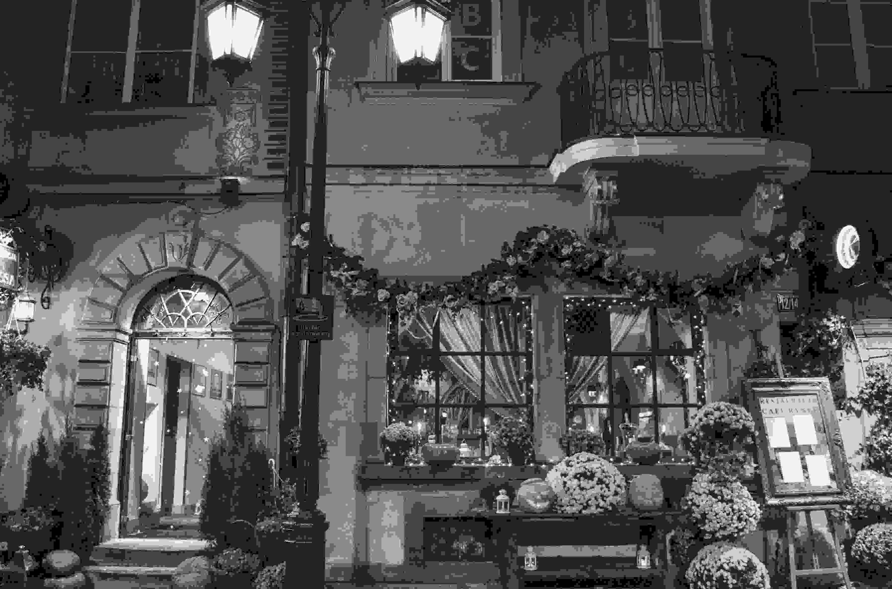

## Overview

PixelFold is an educational implementation of transform-based image compression and a hybrid video codec, designed to make the rate–distortion consequences of each coding stage visible.

## Research problem and motivation

Digital images and video require compact representations, but stronger compression usually reduces reconstruction quality. The project explores that trade-off through executable notebooks and saved sample outputs.

## Approach and methodology

The image path uses 8×8 DCT blocks, quantization, DPCM for DC coefficients, zigzag and run-length coding for AC coefficients, and Huffman entropy coding. The video path uses an IPPP group-of-pictures structure, block motion estimation, residual coding and motion-compensated reconstruction. Additional experiments adjust quantization toward target payload, bitrate or PSNR.

## My contribution

Sandunika maintains the implementation repository. The available documentation does not provide a separate team-contribution statement, so this page limits claims to the checked-in notebooks and outputs.

## Key results and limitations

For the included image sample, saved notebook outputs report 41.32 dB at 6.19:1 compression for the high-quality preset, 28.39 dB at 63.21:1 for medium, and 24.45 dB at 131.67:1 for low. The ratio excludes codebook and file-format overhead. A ten-frame video experiment targeting 40 dB reports 40.09–42.84 dB on the supplied sample; these are not broad codec benchmarks.

## Technologies and methods

- Discrete cosine transform and inverse DCT
- Quantization, DPCM, zigzag and run-length coding
- Huffman entropy coding
- Motion estimation and compensated prediction
- PSNR, compression-ratio and bitrate experiments

## Code

- [PixelFold repository](https://github.com/sandunikalakmali/pixelfold-image-video-codec)

*The cover is a conceptual illustration. The original project visual is retained below.*

