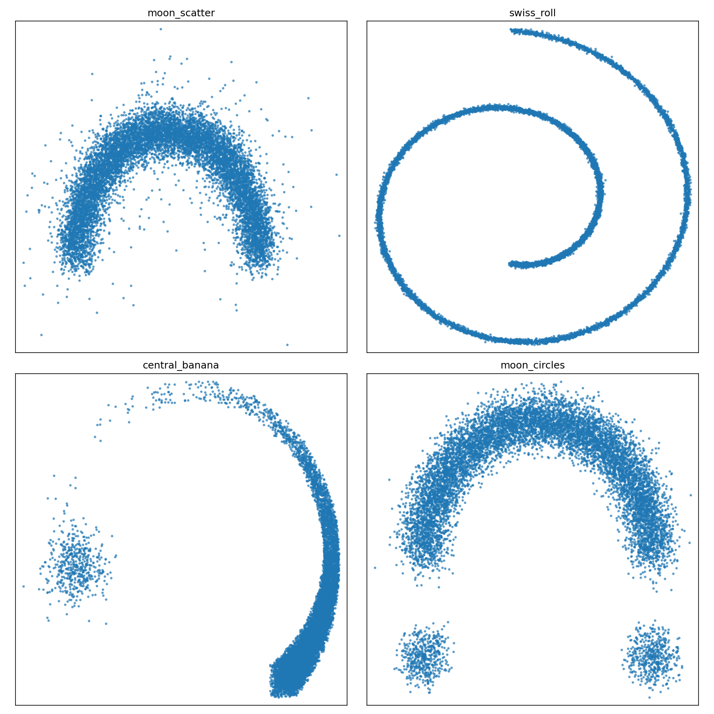

## Overview

This research investigates a failure mode of mean-squared-error noise prediction in denoising diffusion models and tests whether matching predicted-noise trace energy can improve sample fidelity.

## Research problem and motivation

With multimodal conditional targets, an MSE predictor is driven toward a conditional mean. That averaging can reduce the predicted noise energy relative to the target and weaken recovery of fine or less probable modes. The manuscript studies this energy mismatch without replacing the standard denoising objective.

## Approach and methodology

The method augments the DDPM objective with a trace-energy term that compares the energy of predicted and target noise. The public companion repository provides a lightweight PyTorch testbed for related two-dimensional experiments on moon-scatter, Swiss-roll, central-banana and moon-circles distributions. It supports multiple noise schedules, optional exponential-moving-average sampling and precision, recall, density and coverage evaluation.

The repository is supporting evidence for the research direction, not the complete implementation of every manuscript experiment.

## My contribution

Sandunika is the lead-listed author on the manuscript and maintains the related 2D experiment repository. Detailed individual responsibility for every manuscript experiment is not publicly documented, so broader work is described collaboratively.

## Current outcome

The manuscript is **under review for ICLR 2027**. It is not an accepted or published ICLR paper. Results are interpreted metric by metric: trace-energy matching is not presented as improving every metric in every setting. The public repository enables controlled comparisons on synthetic 2D distributions, but it is related experimental code rather than the complete manuscript implementation.

## Technologies and methods

- Denoising diffusion probabilistic models
- Predicted-noise energy regularization
- PyTorch and time-conditioned MLPs
- Cosine, linear and quadratic schedules
- Precision, recall, density and coverage evaluation

## Code and manuscript

- [Related 2D experiments](https://github.com/sandunikalakmali/2DEnDiff-Diffusion)
- [Research manuscript — under review](https://sandunikalakmali.github.io/publications/trace-energy-regularization/)

## Research figure

*Figure: genuine input distributions from the related 2D experiment repository. The cover is a conceptual illustration, not an experimental result.*
